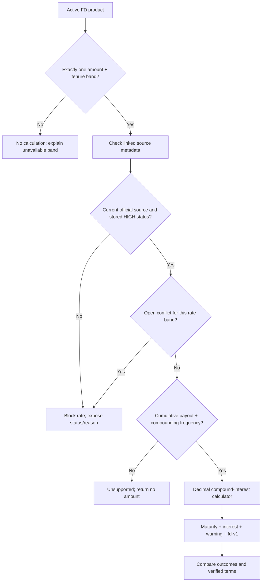

# Codebase walkthrough

This guide is for someone opening Bankwise for the first time. It explains how to run the two applications and follows a comparison from the browser to the backend and back. Use the [repository reference](repository-reference.md) when you want to know what a particular file does.

## 1. Get the project running

You need Python 3.11 or newer and Node.js (20 or newer recommended). Run these commands from the repository root, in two terminals.

### Terminal A: API

```sh
cd backend
python -m venv .venv
source .venv/bin/activate
pip install -r requirements.txt
cp .env.example .env
uvicorn app.main:app --reload --port 8080
```

What the commands do:

- `cd backend` moves into the Python application directory.
- `python -m venv .venv` creates an isolated Python environment in `backend/.venv` so this project's packages do not replace system packages.
- `source .venv/bin/activate` selects that environment for this terminal.
- `pip install -r requirements.txt` installs the API dependencies listed in the requirements file.
- `cp .env.example .env` makes a local settings file. Local defaults use the checked-in JSON catalogue and in-memory sessions; no Google Cloud values are needed.
- `uvicorn ... --reload` starts the API on port 8080 and reloads it after Python edits.

### Terminal B: website

```sh
cd frontend
npm ci
cp .env.example .env.local
npm run dev
```

`npm ci` installs the exact frontend dependency versions from `package-lock.json`; `npm run dev` starts Next.js on port 3000. The example environment points the browser at `http://localhost:8080`. Fill the Firebase web app values in `frontend/.env.local` to use browser sign-in. Open <http://localhost:3000>.

To stop either server, press `Ctrl+C` in its terminal. Do not commit `.env`, `.env.local`, `.venv`, or `node_modules`.

## 2. Learn the route map

The files under `frontend/app/` are route entry points. Each imports a component that implements the screen.

| Browser route | Entry point | What a visitor sees |
|---|---|---|
| `/` | `frontend/app/page.tsx` | Public landing page and query form |
| `/login` | `frontend/app/login/page.tsx` | Email/password, account creation, and Google sign-in |
| `/compare` | `frontend/app/compare/page.tsx` | Latest comparison, trade-offs, sources, and skipped products |
| `/dashboard` | `frontend/app/dashboard/page.tsx` | FD query form and coming-soon categories |
| `/product` | `frontend/app/product/page.tsx` | Details for a product selected from the latest comparison |

`frontend/app/layout.tsx` wraps every route in `AuthProvider`. That provider checks whether a backend session cookie exists and makes the user state available to client components through `useAuth()`.

## 3. Follow a query from landing page to result

The browser-to-backend sequence looks like this:

```mermaid
sequenceDiagram
    actor User
    participant Page as Landing/Dashboard page
    participant Hook as useBankwiseQuery
    participant Client as api-client.ts
    participant API as FastAPI /api/ask
    participant Flow as decision_workflow.py
    participant Compare as comparison + calculator
    participant Store as Local JSON / BigQuery
    participant Sessions as Memory / Firestore
    participant UI as /compare result page

    User->>Page: Enter amount, duration, preferences
    Page->>Hook: runQuery(text)
    Hook->>Hook: redact sensitive text
    alt no valid session
        Hook->>Page: Save redacted pending query in sessionStorage
        Page-->>User: Redirect to /login
    else signed in
        Hook->>Client: askBankwise(redacted text)
        Client->>API: POST /api/ask + cookie + CSRF header
        API->>Flow: run_decision_workflow(query, repositories, user)
        Flow->>Flow: redact again; parse explicit amount/tenure
        Flow->>Store: read active FD product records
        Flow->>Compare: verify, calculate, compare and derive trade-offs
        Compare->>Store: read product rates, sources, conditions, conflicts
        Flow->>Sessions: save redacted requirements and comparison
        Flow-->>API: deterministic decision context
        API-->>Client: shaped JSON response
        Client-->>Hook: AskResponse
        Hook->>Hook: save result in sessionStorage
        Hook-->>UI: navigate to /compare
        UI->>UI: render cards, metrics, source links and explanation
    end
```

### Browser steps

1. `BankwiseQueryForm` collects the text. `LandingPage` or `DashboardPage` submits it through `useBankwiseQuery`.
2. The browser redacts sensitive values before saving a pending query or sending it. The backend repeats redaction as a second boundary.
3. The hook checks auth state. If no server session exists, it saves the **redacted** query under `bankwise:pending-query` in browser `sessionStorage` and routes to login.
4. If authenticated, `askBankwise()` sends `POST /api/ask` through `apiFetch()`. The API client includes credentials and obtains/sends a CSRF token for mutations.
5. When a result arrives, the hook saves its JSON as `bankwise:last-ask` in browser `sessionStorage` and routes to `/compare`. `useLastAsk()` reads that value and `ComparisonPage` passes its fields to display components.

The UI currently uses browser session storage for the result display. The backend also saves an owner-scoped decision record and returns a session ID, but `/compare` does not fetch that saved record to render the screen. Session storage is temporary to the browser tab/session; it is not the durable backend record.

## 4. Follow sign-in

1. `LoginPage` calls `signInWithEmail`, `signUpWithEmail`, or `signInWithGoogle` in `frontend/lib/auth.ts`.
2. Firebase Web SDK returns an ID token. `auth.ts` posts that token to `/api/auth/session`, then signs out of the browser Firebase SDK so the app uses the backend session cookie.
3. `api-client.ts` obtains a signed CSRF token from `/api/auth/csrf` and sends it with the session request.
4. `backend/app/api/auth.py` verifies the Firebase token through `backend/app/firebase.py` and sets an HTTP-only cookie. Future calls include it automatically (`credentials: include`).
5. `AuthProvider` checks `/api/auth/me`. Backend routes reject absent/invalid sessions. Mutating routes also validate origin and CSRF token in `backend/app/api/security.py`.
6. After login, `LoginPage.finishLogin()` reads a pending redacted query and submits it, or routes to the requested page/dashboard.

## 5. Follow the backend decision path

The server assembles route modules in `backend/app/main.py`. It adds request IDs, safe error responses, request logging, CORS, and shared session authentication. `backend/app/api/assistant.py` handles `/api/ask` and calls `run_decision_workflow()`.

The workflow in `backend/app/ai/decision_workflow.py` is named `ai`, but its current user-request path is deterministic and does not call Gemini or ADK:

1. `redact_sensitive_input()` removes identity and credential-like values.
2. `extract_requirements_from_safe_query(..., use_gemini=False)` parses explicit money amounts and durations. It also recognizes simple liquidity phrases and unsupported categories. It does not infer missing numeric requirements.
3. If amount or duration is missing, it saves the redacted requirements and missing-field list, returns a clarification result, and skips catalogue comparison.
4. Otherwise, it selects active FD products through the environment's catalogue adapter.
5. `compare_products()` tests each product's rate bands, asks the verified rate calculator for an outcome, and derives per-product trade-offs from calculated outcomes and verified withdrawal conditions.
6. It saves the comparison in the session repository with the authenticated user ID. Raw query text is not part of the saved session.
7. `to_ask_response()` in `backend/app/ai/ask_response.py` shapes this internal result into UI fields: options, skipped reasons, sources, messages, status, and a three-part deterministic explanation.

## 6. Understand rate eligibility and calculation



The detailed source rules are in [Verification system](verification-system.md); the formula and limits are in [Financial calculations](financial-calculations.md). In short, only one matching, current, conflict-free `HIGH` rate band with a supported cumulative convention can produce a maturity number. Other options may be skipped or displayed with no calculation and an explanation. Trade-offs are derived from calculator output and verified conditions; the UI can format/display them but must not recalculate or replace them.

## 7. Understand data selection

`backend/app/api/dependencies.py` chooses repositories from `ENVIRONMENT`:

| Environment | Catalogue | Decision sessions |
|---|---|---|
| `local` (default; `development` is normalized to local) | `LocalJsonCatalog` reads `backend/data/fd-products.json` | `MemorySessionRepository` in this API process |
| `production` | `BigQueryRepository` reads curated tables | `FirestoreSessionRepository` |

The repositories adapt stored records to the shape consumed by domain functions. The business rules should not depend on whether data came from JSON or BigQuery. Source conflicts are carried alongside products; verification rules determine whether facts can participate in calculations. The verifier reports stored metadata and does not crawl bank websites.

## 8. What “AI” means in this repository

The live query path reports that AI was not used. Optional Vertex AI requirement extraction is present in `backend/app/domain/input.py`; ADK agents and calculator/verifier tools are in `backend/app/ai/` and `backend/app/tools.py`; evaluation fixtures are in `backend/evals/`. These are not called by `/api/ask` today. Read [AI and agent architecture](ai-agent-architecture.md) before changing or enabling them.

## 9. Where to make a change

| Change you want | Start here | Also inspect |
|---|---|---|
| Change a page or route | matching `frontend/app/` or `frontend/components/` | `frontend/hooks/`, `frontend/lib/` |
| Change query parsing/redaction | `backend/app/domain/input.py` | `backend/tests/test_input_redaction.py`, `test_decision_workflow.py` |
| Change matching/eligibility | `backend/app/domain/rates.py` | `backend/tests/test_local_catalog.py`, `test_source_rules.py` |
| Change the FD formula | `backend/app/calculators/fd.py` | `backend/tests/test_fd_calculator.py` |
| Change trade-off behavior | `backend/app/domain/comparison.py` | `backend/tests/test_comparison_tradeoffs.py`, conflict/source tests |
| Change source freshness/conflicts | `backend/app/domain/sources.py` or `conflicts.py` | `backend/tests/test_source_rules.py`, `test_conflicts.py` |
| Change an API contract | `backend/app/api/` and `backend/app/schemas.py` | `docs/api.md`, API/auth tests |
| Change persistence/schema | matching repository and `backend/sql/` | `backend/tests/test_session_ownership.py`, importer tests |

For the complete file map, go to the [repository reference](repository-reference.md). For commands to deploy, go to [deployment](deployment.md).
